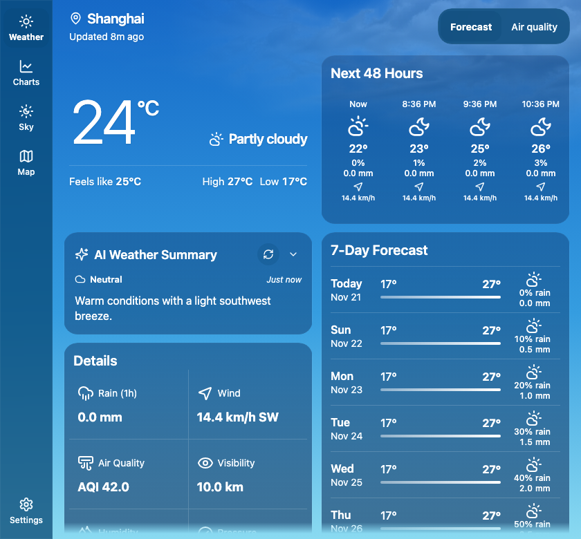
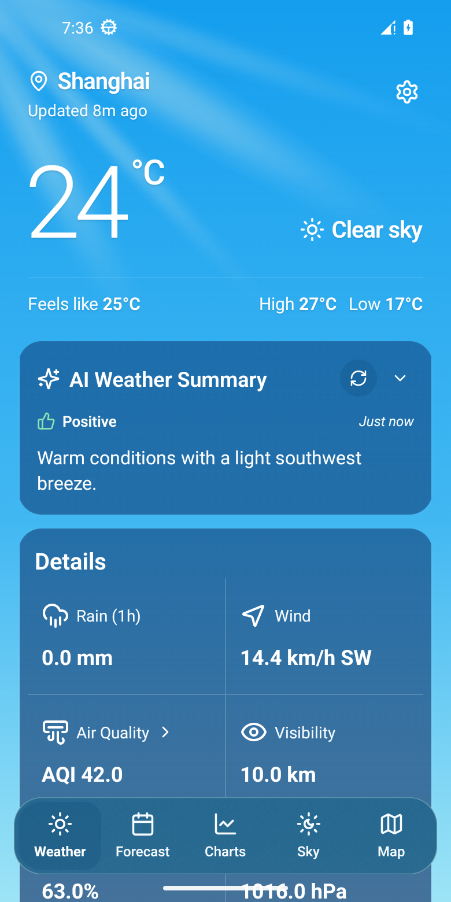
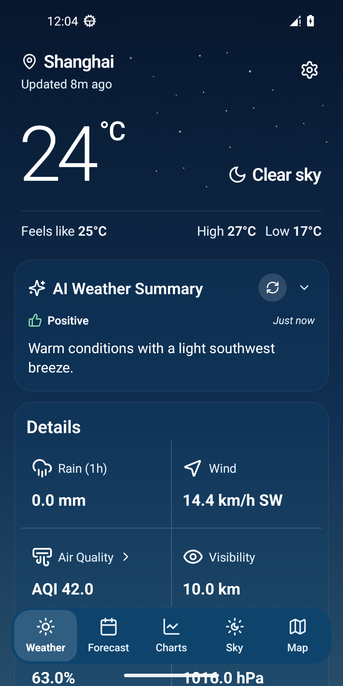

# Clear glass content blocks

Weather Monitor groups forecasts and readings on smooth, tinted glass. A cloud can remain visible through a block while small white labels stay readable over the bright horizon. To reproduce the finish, give the whole screen one backdrop, vary the strength of the tint with the light behind each block, and keep fine texture out of the reading area.



_Cloudy day, unfolded layout in Chromium. Follow the cloud across the top edge of “Next 48 Hours”. The sky continues behind both scrolling panes._

## Build the layers

1. **Give the scene one owner.** Paint a full-viewport gradient behind the content and navigation. Broad shapes such as a cloud bank can cross pane and card boundaries. The main temperature sits directly on the open sky, leaving enough of the backdrop exposed to see what is showing through the blocks. [Backdrop and surface](../components/GlassSurface.tsx)
2. **Keep fine detail in open space.** Put stars, snowflakes, and rain streaks in their own layer. Clip it with a view that has `overflow: 'hidden'` and follows the visible hero area as the screen or its pane scrolls. Otherwise individual bright marks look like grit inside the glass. [Scenery and particle clipping](../components/WeatherScenery.tsx)
3. **Clip the material and draw the content above it.** The default radius is 20 dp. A 1 dp white rim at 6% opacity defines the edge. The decorative layer ignores touches and is hidden from screen readers. Text, icons, and controls sit above it at full opacity. Inside Details, dividers use `rgba(231, 243, 252, 0.18)` and stop 8 dp short of the outer edge. [Surface layers](../components/GlassSurface.tsx) · [Details layout](../components/CurrentConditions.tsx)

| Clear day on Android                                                                                                                                                                                             | Clear night on Android                                                                                                                                                                                                  |
| :--------------------------------------------------------------------------------------------------------------------------------------------------------------------------------------------------------------- | :---------------------------------------------------------------------------------------------------------------------------------------------------------------------------------------------------------------------- |
| [](images/glass-blocks/clear-day-android.png) | [](images/glass-blocks/clear-night-android.png) |

_Both phone captures use Light appearance. Local night changes the sky and the block tint. Notice where the stars end above the summary, and how the floating navigation stays distinct from Details._

## Choose the tint

These are starting values from the app in Light appearance. The three positions are measured from the top of the **backdrop**. Each percentage is the opacity of the tint. For example, the top of the cloudy-day material transmits 79% of the sky color, and the horizon transmits 45%. [All seven palettes and foreground tokens](../utils/weatherTheme.ts)

| Local scene | Sky at 0% / 58% / 100%            | Block tint | Tint opacity at those positions | Opaque fallback |
| ----------- | --------------------------------- | ---------- | ------------------------------- | --------------- |
| Clear day   | `#149EEE` / `#42B8F2` / `#9DE4F6` | `#001B55`  | 38% / 47% / 57%                 | `#35779B`       |
| Cloudy day  | `#1468C7` / `#359DE0` / `#8ADAF1` | `#001C4C`  | 21% / 37% / 55%                 | `#357897`       |
| Clear night | `#07172E` / `#102E50` / `#264D6A` | `#0B426D`  | 26% throughout                  | `#0B426D`       |

For a new palette, choose a dark tint related to the scene hue. Composite each color channel as `tint × opacity + backdrop × (1 − opacity)`. Start with the palest part of the backdrop and increase the tint there until small captions read clearly. Then ease the tint toward the darker part of the scene. Use solid white for primary text. The app uses `#F5FBFF` for secondary text in daylight with Light appearance and `#E7F3FC` otherwise.

Resolve local daylight separately from the user's appearance preference. At night, use one tint opacity across the block. In Dark appearance, the app dims the sky with `rgba(5, 18, 33, 0.16)` and lowers each content opacity by five percentage points. It also mixes the scene's ink 30% toward `#051221` for the solid fallback and nighttime tint. [Theme resolution](../utils/weatherTheme.ts)

## Render the block

| Where it runs                                                                                 | Content block                                                                                         | Navigation bar or rail                                                                                                          |
| --------------------------------------------------------------------------------------------- | ----------------------------------------------------------------------------------------------------- | ------------------------------------------------------------------------------------------------------------------------------- |
| iOS and eligible Android                                                                      | Composite the tint directly over the scene. Native blur produced visible grain in the reading blocks. | Native `BlurView` at intensity 35. Android uses one shared `BlurTargetView` around the backdrop and `dimezisBlurViewSdk31Plus`. |
| Browser with backdrop-filter support                                                          | 10 px backdrop blur beneath the tint                                                                  | 24 px backdrop blur beneath the navigation tint                                                                                 |
| Reduced transparency, unsupported browser, or Android below API 31 or without a shared target | Solid `theme.surface`                                                                                 | Solid `theme.surface`                                                                                                           |

The same solid fill is available explicitly through `opaque`, as used in Settings. The app also uses it for inactive scenes. Keep the foreground, radius, and spacing consistent when switching materials. [Rendering decisions](../components/GlassSurface.tsx) · [Expo SDK 57 blur target](https://docs.expo.dev/versions/v57.0.0/sdk/blur-view/)

### React Native and Expo

This example uses the repository's components inside a safe-area provider. `SurfacePreferences` reads the transparency preference, `WeatherBackdrop` owns the scene, and `ScrollingScreen` supplies scroll and layout measurements. The existing tab shell already provides the first two around its screens. [App root](../app/_layout.tsx) · [Tab shell](../components/AdaptiveNavigation.tsx) · [Scrolling screen](../components/ScrollingScreen.tsx)

```tsx
import { Text } from 'react-native';
import {
  GlassSurface,
  SurfacePreferences,
  WeatherBackdrop,
} from './components/GlassSurface';
import { ScrollingScreen } from './components/ScrollingScreen';
import { getTheme } from './utils/weatherTheme';

const theme = getTheme('clouds');

export function HumidityExample() {
  return (
    <SurfacePreferences>
      <WeatherBackdrop theme={theme} showScenery>
        <ScrollingScreen theme={theme} title="Conditions">
          <GlassSurface theme={theme} style={{ padding: 16, gap: 6 }}>
            <Text style={{ color: theme.textSecondary }}>Humidity</Text>
            <Text style={{ color: theme.text, fontSize: 20 }}>63%</Text>
          </GlassSurface>
        </ScrollingScreen>
      </WeatherBackdrop>
    </SurfacePreferences>
  );
}
```

**Anchor the daylight tint to the scene.** Size the tint gradient to the backdrop's height. Measure the backdrop and the card in the same frame, then translate the gradient inside the card by `backdrop.pageY − card.pageY`. Extend the first and last colors beyond the gradient to cover tall or partly offscreen cards. The app repeats this measurement on scroll, resize, and content layout, with a scroll offset for each independent pane. This handles a long summary collapsing before the next scroll event arrives. A translucent daylight block rendered without a viewport provider uses the horizon tint. [DaylightGlass](../components/GlassSurface.tsx) · [Independent pane measurements](<../app/(tabs)/index.tsx>)

### Standalone browser example

Save this snippet as an HTML file to try the cloudy-day material. Each stop is expressed in pixels relative to its card, so two blocks at the same screen height get the same tint. CSS extends the end colors automatically. In a dynamic layout, register newly mounted blocks and realign after content above them moves.

```html
<!doctype html>
<meta name="viewport" content="width=device-width, initial-scale=1" />
<style>
  .scene {
    position: fixed;
    inset: 0;
    overflow: auto;
    padding: 18vh 16px 16px;
    background: linear-gradient(#1468c7, #359de0 58%, #8adaf1);
    font:
      16px/1.5 system-ui,
      sans-serif;
  }
  .glass {
    display: grid;
    gap: 4px;
    max-width: 28rem;
    margin: 0 auto;
    padding: 16px;
    color: white;
    border: 1px solid rgb(255 255 255 / 6%);
    border-radius: 20px;
    background: #357897;
  }
  .glass + .glass {
    margin-top: 12px;
  }
  .glass small {
    color: #f5fbff;
  }
  @supports (backdrop-filter: blur(10px)) or
    (-webkit-backdrop-filter: blur(10px)) {
    .glass {
      background: var(--daylight, #357897) border-box;
      -webkit-backdrop-filter: blur(10px);
      backdrop-filter: blur(10px);
    }
  }
  @media (prefers-reduced-transparency: reduce) {
    .glass {
      background: #357897;
      -webkit-backdrop-filter: none;
      backdrop-filter: none;
    }
  }
</style>
<main class="scene">
  <section class="glass" aria-label="Humidity">
    <small>Humidity</small><strong>63%</strong>
  </section>
  <section class="glass" aria-label="Pressure">
    <small>Pressure</small><strong>1016 hPa</strong>
  </section>
</main>
<script>
  const scene = document.querySelector('.scene');
  const cards = scene.querySelectorAll('.glass');

  function alignTint() {
    const sky = scene.getBoundingClientRect();
    for (const card of cards) {
      const top = sky.top - card.getBoundingClientRect().top;
      const stops = [
        `rgb(0 28 76 / 21%) ${top}px`,
        `rgb(0 28 76 / 37%) ${top + 0.58 * sky.height}px`,
        `rgb(0 28 76 / 55%) ${top + sky.height}px`,
      ];
      card.style.setProperty(
        '--daylight',
        `linear-gradient(${stops.join(', ')})`,
      );
    }
  }

  const resize = new ResizeObserver(alignTint);
  resize.observe(scene);
  cards.forEach((card) => resize.observe(card));
  scene.addEventListener('scroll', alignTint, { capture: true, passive: true });
  alignTint();
</script>
```

## Check a port

- Sample the smallest secondary label against the composited fill from top to horizon. The app's palette test checks 101 positions and requires at least **4.65:1** for that label. Also inspect the brightest artwork visible through a real block. [Contrast tests](../__tests__/utils/weatherTheme.test.ts)
- Scroll until the hero disappears. Stars and precipitation should disappear with it. In a two-pane layout, scroll one pane and look for continuous color across the stationary pane.
- Expand a block beyond one screen, scroll to its bottom, then collapse it. Check the corners and the bottom edge for a strip of stale color. [Surface regression tests](../__tests__/components/GlassSurface.test.tsx)
- Enable reduced transparency and check the same screen. Labels and controls should retain their size, color, and hit areas on the solid fill.
