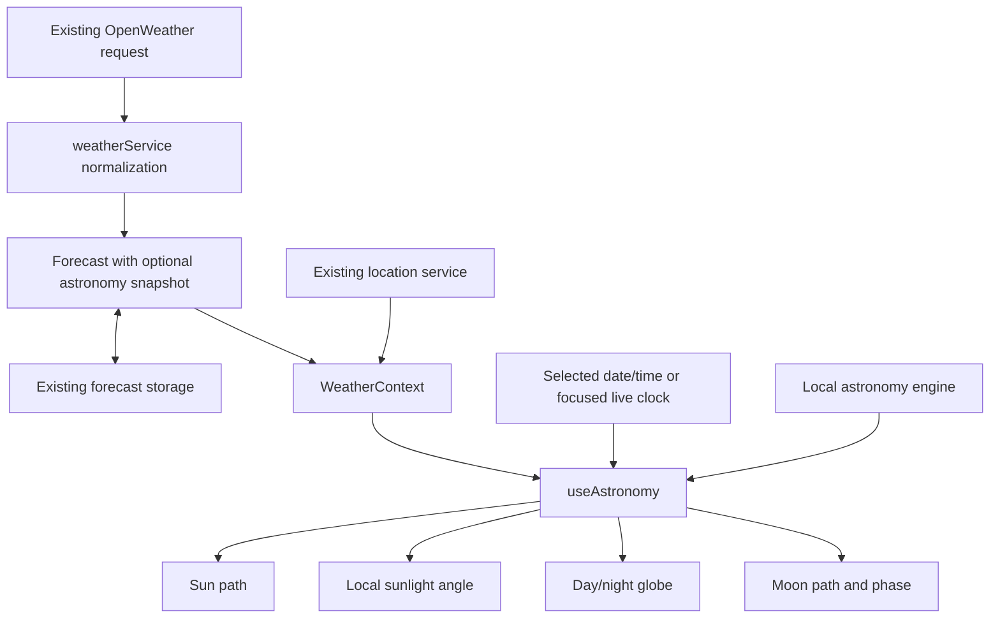

# Sun & Moon tab: feasibility and design

Status: approved design reference, 25 October 2026. The original assessment is retained below. See [implementation and verification](sun-moon-tab-implementation.md) for the implemented behavior, dependency decision, and remaining device checks.

## Decision

The feature is feasible with the existing weather services plus local astronomy calculations. Keep OpenWeather One Call 3.0 for its daily event times, calculate positions and illumination on the device, and draw the interface with the already installed `react-native-svg`. No additional hosted astronomy API, backend, API key, or network request per time-slider movement is needed.

The requested sunlight feature includes **both** the local angle above the ground and a globe showing sunlight across Earth. The reference image mentioned in the request was not attached; the proposal interprets “upper” and “lower” as a Sun chart above a Moon chart.

## What the current APIs provide

| Requirement                                         | Available from the existing integration?                   | Proposed source                                                                       |
| --------------------------------------------------- | ---------------------------------------------------------- | ------------------------------------------------------------------------------------- |
| Sunrise and sunset                                  | Yes: `current.sunrise/sunset` and `daily[].sunrise/sunset` | Preserve the daily One Call values; calculate a fallback when unavailable             |
| Sun location in the local sky                       | No altitude or azimuth in the current response             | Calculate from coordinates and the selected UTC instant                               |
| Local sunlight angle                                | No angle in the current response                           | Calculate geometric solar elevation; incidence on horizontal ground is its complement |
| Day/night globe and point where the Sun is overhead | Not supplied by the current weather responses              | Calculate the geocentric Sun direction and Earth's rotation                           |
| Moonrise and moonset                                | Yes: `daily[].moonrise/moonset`                            | Preserve One Call values; calculate a fallback                                        |
| Moon phase                                          | Yes: `daily[].moon_phase`, a daily phase-cycle value       | Preserve it; calculate instantaneous phase and illuminated fraction for the slider    |
| Moon location in the local sky                      | No altitude or azimuth in the current response             | Calculate topocentric Moon coordinates                                                |

OpenWeather's documented current/forecast response covers eight daily records. `moon_phase` is a position in the lunar cycle, **not** illuminated percentage: a phase value of 0.5 means full Moon. The provider's daily phase is also not an exact phase for every instant within that day. [One Call 3.0 documentation](https://openweathermap.org/api/one-call-3#current).

Caiyun's daily forecast documents sunrise/sunset under `result.daily.astro`. Its documented daily fields do not fill the Sun/Moon position or lunar-phase gaps, so a second provider integration is unnecessary. [Caiyun daily forecast](https://docs.caiyunapp.com/en/weather-api/v2/v2.6/4-daily.html).

The existing One Call subscription and normal refresh limits continue to apply. Reusing the existing response and doing the new calculations locally adds no astronomy requests. This assessment uses code and public documentation; it does not test the user's live account entitlement. OpenWeather currently recommends v4 for new integrations, but this feature does not require migrating the app's existing v3 integration.

## Findings in this repository

- [`services/weatherService.ts`](../services/weatherService.ts) calls `/data/3.0/onecall` with `exclude=minutely,alerts`, so daily astronomy fields are already requested. `transformOneCallToForecast()` discards them and the IANA time-zone name.
- [`types/weather.ts`](../types/weather.ts) already declares `moonrise`, `moonset`, and `moon_phase` in `OneCallResponse.daily`; the normalized `DailyForecast` contains none of them. Sunrise/sunset are currently typed as required even though the provider documents missing values during polar day/night.
- [`contexts/WeatherContext.tsx`](../contexts/WeatherContext.tsx) owns the coordinates, forecast, theme, refresh, and storage flow. [`services/backgroundWeatherService.ts`](../services/backgroundWeatherService.ts) uses the same weather service and saves the same forecast object. Astronomy metadata should travel with that object.
- [`utils/weatherStorage.ts`](../utils/weatherStorage.ts) persists the forecast as JSON. Old cached records will not contain astronomy metadata and must remain readable.
- [`components/CustomChart.tsx`](../components/CustomChart.tsx) and the installed `react-native-svg` provide an existing rendering pattern. The astronomy charts need a fixed horizon, negative elevations, event markers, and a shared cursor, so a small dedicated component is preferable to changing every weather chart.
- [`hooks/useNow.ts`](../hooks/useNow.ts) provides a minute clock. Add a focused/active-screen lifecycle for this tab's live mode; the current hook runs its interval while mounted.
- [`app/(tabs)/_layout.tsx`](<../app/(tabs)/_layout.tsx>) already has Weather, Forecast, Charts, Map, and Settings. The README's legacy `/weather` and `/forecast` endpoint descriptions are out of date; this assessment follows the running service code.

## Architecture



**Shared data:** extend `ForecastResponse` with an optional versioned `astronomy` snapshot. It contains the response coordinates, IANA time-zone name, UTC offset as a fallback, fetch time, and provider daily astronomy records. Attach it in `transformOneCallToForecast()`. It then follows the existing context, foreground/background refresh, fetch lock, and storage paths without a new global context or a separate network service.

**Derived data:** introduce a pure `astronomyService` adapter that hides the calculation library from the UI. The initial recommendation for the complete local-sky and globe scope is `astronomy-engine` **2.1.19**, MIT licensed, with a JavaScript implementation, TypeScript declarations, and public global coordinate transforms. Validate Expo/Hermes and web bundling in an implementation spike before committing to the dependency; published package size is not the same as the app's release-bundle increase. [Project](https://github.com/cosinekitty/astronomy), [JavaScript API](https://github.com/cosinekitty/astronomy/blob/master/source/js/README.md).

**SunCalc alternative:** the user's suggested `suncalc` is a strong candidate for the local views, not merely a rise/set helper. The published version checked was **2.1.1**, with bundled TypeScript declarations. Its public methods cover all of these capabilities:

| SunCalc method                                | Use in this feature                                                 |
| --------------------------------------------- | ------------------------------------------------------------------- |
| `getPosition(date, lat, lng)`                 | Sun altitude, compass bearing, and samples for its daily path       |
| `getTimes(date, lat, lng, height, utcOffset)` | Sunrise, sunset, solar noon, and twilight events                    |
| `getMoonPosition(date, lat, lng)`             | Moon altitude, bearing, distance, and parallactic angle             |
| `getMoonIllumination(date)`                   | Moon phase-cycle value, illuminated fraction, and bright-limb angle |
| `getMoonTimes(date, lat, lng, utcOffset)`     | Moonrise/moonset and all-day horizon states                         |

These calculations use time and coordinates locally. The ground-angle view can use solar altitude, provided its apparent/geometric convention is explicit. SunCalc computes solar right ascension and declination internally but does not expose them through its public API; the globe therefore needs an additional validated solar-direction calculation or coordinate derivation. That is the reason to prefer Astronomy Engine for the full scope, rather than a lack of local Sun/Moon features in SunCalc. Keep SunCalc plus a solar-geometry helper as the lightweight alternative in the implementation spike; do not ship both full calculation libraries by default. [SunCalc 2.1.1 documentation](https://github.com/mourner/suncalc/blob/v2.1.1/README.md), [source](https://github.com/mourner/suncalc/blob/v2.1.1/index.js).

Pin the chosen SunCalc version. Version 2.1.1 returns **degrees**, with azimuth clockwise from north, and **refraction-corrected apparent altitude**. Older 1.x examples use radians and azimuth measured from south toward west. Applying an old conversion to v2 results would corrupt the chart and compass. The adapter must also distinguish apparent altitude from the geometric altitude required by the proposed ground-plane and terminator calculations; v2's position methods do not expose an airless-altitude option. Its numeric `utcOffset` selects a fixed-offset day window and does not replace the application's IANA-zone/DST handling. [Version 1.9.0 conventions](https://github.com/mourner/suncalc/blob/v1.9.0/README.md#sun-position).

**Screen state:** `useAstronomy` consumes the context and owns only the tab's selected local date, selected instant, live/preview mode, and globe camera. Derive the leading section from the selected instant's solar period: Moon at night, Sun during the day. This uses the same location and normalized event timeline as the rest of the screen and needs no extra API request or persisted ordering preference. The minute clock stays outside `WeatherContext`, avoiding a whole-app render every minute. Cache sampled paths by coordinates, local-date UTC boundaries, and engine version. Calculate the current marker directly rather than snapping it to a path sample.

Suggested new files:

```text
app/(tabs)/sky.tsx
types/astronomy.ts
services/astronomyService.ts
hooks/useAstronomy.ts
utils/astronomyTime.ts
components/astronomy/CelestialPathChart.tsx
components/astronomy/SunlightAngle.tsx
components/astronomy/DayNightGlobe.tsx
components/astronomy/MoonPhase.tsx
assets/astronomy/world-land.json
```

Existing files to extend during implementation: `types/weather.ts`, `services/weatherService.ts`, `app/(tabs)/_layout.tsx`, and forecast hydration/validation in `utils/weatherStorage.ts`. Update context/background tests to verify metadata survives the existing Caiyun merges and storage cycle. If Settings moves, relocate its route to `app/settings.tsx` and provide a back action and a consistent header entry point.

### Domain contract

Use UTC milliseconds and degrees at the domain boundary; convert OpenWeather's Unix seconds once. Proposed shape, not an implementation:

```ts
type EventResult = {
  timesUtcMs: number[];
  status: 'events' | 'none_on_date' | 'unknown';
  source: 'openweather' | 'calculated';
};

type AstronomySnapshot = {
  schemaVersion: 1;
  latitude: number;
  longitude: number;
  timeZoneId?: string;
  utcOffsetSeconds: number;
  fetchedAtUtcMs: number;
  days: Array<{
    localDate: string;
    sunrise: EventResult;
    sunset: EventResult;
    moonrise: EventResult;
    moonset: EventResult;
    providerMoonPhase: number | null;
  }>;
};

type SkyPosition = {
  altitudeDeg: number;
  azimuthDeg: number; // True north = 0; east = 90; clockwise.
};

type AstronomyInstant = {
  atUtcMs: number;
  solarPeriod: 'day' | 'night' | 'unknown'; // Sunrise/sunset convention, not theme.
  sun: SkyPosition;
  moon: SkyPosition;
  moonPhaseCycle: number; // 0..1; normalize the selected library's convention.
  moonIlluminatedFraction: number; // 0..1, a separate quantity.
  subsolar: { latitudeDeg: number; longitudeDeg: number };
  sunlightIncidenceDeg: number | null; // Null when Sun is below the ground plane.
};
```

Missing API event values initially mean `unknown`, not `none_on_date`. Local calculation resolves the distinction. Event lists avoid assuming one rise followed by one set within every calendar day. Normalize invalid, missing, zero, or out-of-date provider timestamps before displaying them.

### Calculation and source rules

1. **Local sky:** use observer-relative Sun and Moon coordinates. Topocentric Moon position matters because the observer's location shifts its apparent position. Expose geometric elevation for the ground-angle diagram and matching chart; optional apparent elevation can be an explicitly labeled detail.
2. **Surface angle:** elevation `α` is the angle between the direction toward the Sun and a horizontal ground plane. For `α > 0`, incidence measured from the upward surface normal is `90° − α`. Below the horizon, show “No direct sunlight.” This describes level ground, not a sloping roof, terrain shading, cloud attenuation, or solar power.
3. **Globe:** derive the Sun's geocentric equatorial coordinates of date, then rotate by Greenwich apparent sidereal time into Earth coordinates. With right ascension and sidereal time in hours, longitude is `wrap180(15 × (RA − GAST))`; declination gives subsolar latitude on the schematic spherical globe. A surface normal dotted with the Sun direction determines the day/night side; zero marks the geometric terminator. Use geocentric coordinates here, not the observer's local altitude.
4. **Events:** prefer valid provider times for the matching location/date; calculate unavailable events locally. Record the source per event. Use the engine's rise/set search, not an arbitrary zero crossing of sampled center altitude: apparent limb size and refraction affect rise/set. Do not warp calculated paths to force exact agreement with provider times.
5. **Moon phase:** calculate phase and illuminated fraction for the selected instant. The retained provider daily phase is useful for checking the day summary, not driving a time-varying phase disk. Start with a clearly labeled north-up phase diagram; an orientation matching the observer's view would need bright-limb and parallactic-angle handling.
6. **Clock and calendar:** use the response's IANA zone, never device-local `setHours()` to group remote-location events. A local day can have 23, 24, or 25 hours. Convert successive local midnights to UTC, sample between those instants, and include zone offsets in ambiguous repeated-hour labels. If only an offset is known, label the fixed UTC offset and avoid implying DST-aware future dates.
7. **Section priority:** determine day/night from the same normalized sunrise/sunset timeline used for event labels, comparing UTC instants. Day starts at sunrise; night starts at sunset and continues through local midnight until the next sunrise. Resolve dates without an ordinary event pair using the calculated solar horizon state under the engine's rise/set convention, including polar day/night. Do not equate a missing event or a geometric center-altitude crossing with sunset. If calculation is unavailable, retain the last known order for that location, or use Sun first initially, without asserting that it is daytime.

The globe uses a bundled, simplified geographic dataset projected orthographically into SVG. This creates a rotatable globe without a WebView, map-tile service, GPU scene, or texture downloads. A small pure-JavaScript projection library can supply the geometry; verify its Metro imports. Keep the Sun/Moon computation independent of the projection/rendering choice.

### Performance and failure behavior

- Start with 10-minute path samples for both bodies, with exact selected-time positions and exact event searches. Memoize by location/day; refine sampling near sharp features if required by visual testing.
- Update live values once per minute only while this screen is focused and the app is active. On foreground/focus, update immediately. Pause live mode when the user scrubs and resume using “Now.”
- Recompute paths on date/location changes; recompute the globe's daylight mask on time changes. Rotating the globe changes only the camera, never the observer location or astronomy values.
- Use the shared weather refresh policy. Moving the time slider, rotating the globe, or entering the tab must not issue new weather requests by itself.
- Persist provider metadata with the existing forecast; keep computed curves in memory. Accept old snapshots without astronomy, calculate locally, and fill provider fields on the next ordinary weather refresh.
- Reject a cached snapshot when its coordinates do not match the active observer. Use the response location and matching zone together; do not combine a new GPS fix with an old city's time zone.
- With saved coordinates/time zone, astronomy continues offline even when weather refresh fails. With coordinates but no reliable zone, calculation still works and the UI can display explicitly labeled UTC. With no coordinates, provide the existing location recovery action and never show invented local positions.
- Handle calculation failures separately from weather errors. Catch asynchronous loading/storage failures according to the project's service conventions. Keep “unknown,” “no event today,” and “above/below horizon all day” as distinct states.

## UI proposal

**Navigation:** bottom tabs become Weather, Forecast, Charts, Sky, Map. The screen title is “Sun & Moon,” with a Sun/Moon icon for Sky and a Settings gear in the common header. This avoids squeezing six destinations into a narrow phone. Keeping Settings in the tab bar is possible, but six items would need additional small-screen and large-text validation.

**Shared controls:** city/coordinates and local time zone, a day selector initially covering today plus seven days, and one time slider controlling all four views. Initial app mode is live; scrubbing changes to a clearly labeled preview. The selected time is a single UTC instant, with a shared cursor on both charts. Make “Now” available without resetting the location or globe rotation.

**Recommended daytime order:**

1. **Sun, upper section.** A sampled elevation-versus-local-time curve with a clearly labeled 0° horizon. Draw the below-horizon portion with a dashed stroke. Show the selected position, altitude, compass direction plus numeric true bearing, sunrise, sunset, and day length. Do not draw a generic semicircle: latitude and season change the actual path.
2. **Sunlight on Earth, middle section.** A local cross-section of a ray meeting level ground, with elevation and incidence labeled. Immediately below it, a rotatable globe shows daylight/night, the selected location, and the point where the Sun is directly overhead. Include “My location” and “Sun overhead” camera actions; rotation does not change the observer. Keep this section open by default so both requested views are visible.
3. **Moon.** Lead with the phase disk, phase name, and illuminated percentage, followed by the path chart and moonrise/moonset, selected altitude, and bearing. Use the same time axis and elevation scale as the Sun. The Moon may be above the horizon during the day or have a set event before its rise event on the selected date.

**Nighttime order:** Moon → Sunlight on Earth → Sun. Move the whole Moon section to the first position, keeping its phase above its path. Use sunset/sunrise at the selected location: live mode follows the current instant, and time preview follows the slider. This priority is independent of the app's light/dark theme and of whether the Moon is above the horizon. At night with the Moon below the horizon, keep its phase first and label its visibility clearly. Polar day/night follows the calculated solar state.

Change section order only when the day/night period changes, not on every clock tick or redraw. Keep the date/time controls in place, preserve focus and scroll position, and make screen-reader order match visual order. Avoid animated swapping while the user is scrubbing.

An alternative “Charts first” arrangement keeps the two paths together: Sun → Moon → Sunlight on Earth during the day, Moon → Sun → Sunlight on Earth at night. It improves visual comparison at the cost of moving the Earth view lower in the page. The interactive proposal provides both arrangements with the same day/night priority.

Reuse `ScrollingScreen`, native system typography, Lucide icons, safe-area handling, and `WeatherContext.theme`. Use the app's surface colors, a Sun accent, a distinct Moon stroke, and text/line styles in addition to color. Keep the globe base map subdued so the daylight boundary and location remain clear. On larger screens, put local angle and globe alongside one another; keep the Sun and Moon charts vertically aligned.

Accessibility: 44-point effective touch targets; readable labels at large text sizes; keyboard and screen-reader time controls; a textual summary of every chart and globe; reduced-motion support; no meaning communicated only by yellow/blue or brightness. Keep the preview's footer in document flow; the actual native app uses its normal tab bar.

## Implementation and verification plan

1. **Calculation spike:** compare Astronomy Engine with SunCalc plus the globe's required solar-geometry helper, then add the chosen implementation in an isolated change. Verify Hermes/web import, release-bundle impact, and calculation latency. Check at least one ordinary northern and southern location, a near-equatorial location, a polar date, and a DST transition. Compare a small set of events/positions with an independent authoritative ephemeris, not only the same library's output.
2. **Data plumbing:** preserve provider astronomy and time-zone metadata; update optional-event typing and affected consumers; validate existing cached records and round trips through foreground/background storage and Caiyun merges.
3. **Local charts:** add Sky navigation, date/time selection, Sun and Moon paths, phase, event labels, and the ray-angle diagram. Verify preview/live switching and correct shared UTC time.
4. **Globe:** bundle licensed geography, add daylight shading, location/subsolar markers, and camera gestures. Verify the dateline, polar daylight, backside marker visibility, and independent camera rotation.
5. **Acceptance:** all four views agree on the selected instant and location; tab entry/scrubbing/rotation make zero extra weather requests; offline and missing-event states work; no event is rendered as 00:00 or 1970 by fallback; local-date grouping survives 23/25-hour days; both hemispheres and narrow/foldable layouts remain usable. Verify Moon-first ordering after sunset and before sunrise, Sun-first ordering during the day, and correct transitions when changing the date, location, or preview time. Check polar states, a nighttime Moon below the horizon, stable focus/scroll, and matching screen-reader order. Run `npm run preflight` and test the interactive screen on Android, iOS, and web.

## Design preview evidence

The preview uses Shanghai (31.2304° N, 121.4737° E), 25 October–1 November 2026, and locally calculated astronomy samples. It initially opens at 21:00 to demonstrate Moon-first ordering; moving the time slider into daylight restores Sun-first ordering. A previously saved preview time is retained. These are illustrative location/date choices, not a reading of the user's GPS or an OpenWeather response. Event times in the preview are calculated. The phase disk is north-up; the globe uses the published `@d3-maps/atlas` 1.0.0 world geometry. The preview interpolates saved samples to demonstrate interaction; the proposed app computes the selected position directly.

Documentation and source inspection establish feasibility. A Node calculation check exercises the proposed astronomy methods, but is not a native-device performance or integration test.

Verification completed for this proposal: 1,160 finite astronomy samples across eight days; the calculated subsolar point places the Sun overhead; polar summer/winter checks return no sunrise in the selected day; mocked-DOM checks pass for date/time selection, synchronized values, both arrangements, finite projected map paths, and camera changes independent of observer coordinates. Ordering checks cover sunrise, sunset, pre-dawn, date changes, and a nighttime Moon below the horizon; phase precedes the Moon path in both arrangements, and slider focus survives reordering. Project preflight passed all 16 suites / 178 tests. Browser policy blocked opening the local preview file, so visual layout and real touch interaction remain unverified.
